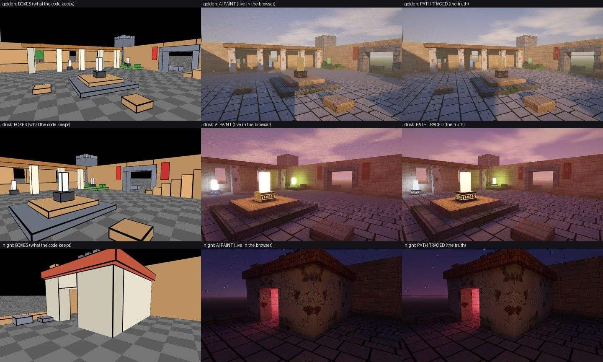

# Paintbox

**The code keeps the world as boxes. Three small AI painters paint every pixel you see, live, in the browser, on any GPU.**

*Left: what the code draws. Middle: what the painters paint from it, live, in about 3.5 ms a frame on a 2020 M1 MacBook. Right: the
path-traced truth they learned from, about 70 seconds a frame.*

The example game is **Dusk Yard**: light the five crystals after the sun goes down; the shades drift through the stone toward you
and burn in the light. It plays in any browser with WebGL2, on a computer or a phone (measured in Chrome's and Safari's engines).

## Play it

    npm install          # Playwright, for the bake and the checks (the game itself needs nothing)
    npm run serve        # then open http://127.0.0.1:8737/game/index.html

The trained painters are in the repository (`game/*.bin`, 11.4 MB), so it plays at once. Press **1** and **2** (or the buttons at
the top) to flip between the boxes the code keeps and the painted frame.

## How it works

Matrix-Game 4.0 (Skywork, October 2026) splits a game in two. Code runs the world as flat boxes, and a 5-billion-parameter video
model, trained on box renders paired with Unreal Engine 5 renders of the same frames, redraws every frame. It runs on NVIDIA's
CUDA, and its browser demo is a video streamed from a GPU server. Paintbox makes the same split small enough for the GPU in the
player's own phone or laptop:

1. **The world is code** (`game/world.js`): every box, what each is made of, the beacons, the sun and the sky's colours through
   the day. The game's rules (`game/main.js`) work on these boxes and nothing else.
2. **A detailed world exists only in training** (`bake/truth.js`). It plays the part Unreal Engine plays for Matrix-Game: each
   material as code (sandstone ashlar with chipped corners, flagstones at their own tilts, planks with iron bands, roof tiles,
   plaster with brick showing through, glowing runes, a cloudy sky), plus the world's own wear (damp at the foot of the walls,
   moss where water stands).
3. **A path tracer renders the truth** (`bake/pt.js`, WebGL2 on your own GPU): five million points of the detailed world, under
   the sky, the sun and each light separately, at every hour.
4. **Three painters learn it** (`bake/train*.py`, numpy):
   - **light**: a grid of learned numbers plus a 24 → 32 → 32 → 18 network; the light at any point from the sky and from each
     beacon at unit strength, so beacons switch on, dim and pulse for free (light adds);
   - **surfaces**: a learned 8-feature texture per material, a half-metre grid of the world's wear, and a 20 → 16 → 16 → 9 network
     that says how each point takes each light; it also paints the moving things' cloth, skin and smoke;
   - **sky**: a learned texture over the cloud deck plus a 16 → 16 → 16 → 3 network.
5. **The browser runs them** (`game/render.js`, `game/painter.js`, plain WebGL2, no engine, no libraries). Each frame the light
   painter repaints a light atlas (a texel every 20 cm on every surface); the surface painter runs at every pixel; the sky painter
   at every sky pixel. The code still decides the boxes' outlines, where the sun reaches, each moving part's colour, how brightly
   each crystal glows and where the stars are, and adds the camera's haze, exposure and glow.

## Make your own world

1. **The level** (`game/world.js`): add, move or remove boxes with `B(x0, y0, z0, x1, y1, z1, 'material')`. A box's material
   names a row of `MAT` and `MAT_UV`. The beacons are `BEACONS`; the playable area is `PLAY`; the painters' volume is `GRID`
   (keep the level inside it).
2. **The look** (`bake/truth.js`): a material is a function of its pattern coordinates that returns its albedo, its height (for
   the bumps), its cavity and its glow (`Surf`). Rules a painter can learn:
   - a pattern repeats exactly on its material's tile (`MAT_UV`), so every noise frequency times the tile is a whole number (the
     helpers `tn`, `tf` and `tcell` take care of it when you pass the tile);
   - detail finer than the texture's texel (tile ÷ 256: 1.6 cm on a 4 m tile) blurs;
   - the world's own wear (`weather()`) changes slowly, over a metre or more;
   - a banner, a crate or a pedestal takes its pattern from its own box (`MAT_UV` mode 1) so each one shows the whole design.
3. **Look at the detailed world before anything learns it:** `npm run truth` path-traces it from the cameras in
   `bake/views_truth.json` into `out/truth/`.
4. **Bake and train:** `npm run make:quick` (about 5 minutes) checks the whole loop; `npm run make` is the real one (about 6
   minutes of baking on an M1's GPU and 21 minutes of training on its CPU). Python 3 with numpy (`PYTHON=...` to choose one).
5. **Check it:**
   - `npm run look` renders the same cameras in the game and in the path tracer, side by side, with each frame's time;
   - `npm test` plays the rules;
   - `npm run devices` boots it in Chromium and WebKit, on a desktop and as a phone held upright and turned, and measures the
     frame rate.
6. **Ship it:** `npm run pack` zips the game (`out/game.zip`). To put it on NotesMosaic, where it plays on any phone or computer
   with no download, connect your AI to the NotesMosaic MCP (https://notesmosaic.com/developers/mcp) and have it read the skill:
   `read_skill {"name": "paintbox"}`. It uploads the build, writes its rights declaration and runs the platform's playtest in
   Chromium and WebKit. The game goes public only when you say so.

Your own rules live in `game/main.js` (the rules, the input, the camera, the HUD). Footage: `npm run broll` records the camera
moves in `bake/shots.json`; `npm run gameplay` records a bot playing by the rules (`bake/plays.json`), the HUD and all.

## Numbers (measured on a 2020 13" MacBook Pro, Apple M1, 8 GB)

| | |
|---|---|
| What the painters learned | 10,318,514 numbers, 11.4 MB (3,806 network weights; the rest are feature textures and grids) |
| How close to the path tracer | 3.3 levels out of 255 on screen, on average, at points they never trained on |
| One 960×540 frame | 3.5–4.0 ms painted, against 66–78 s path-traced |
| In a browser | 60 fps in Chrome's and Safari's engines, desktop and phone-sized, upright and turned |

## What it is not

- It isn't Matrix-Game's model, and it doesn't do what that model does. Both learn one scene; theirs redraws the whole frame like a
  video and can change what a box's outline shows. Ours paints the surfaces of the boxes and the sky, and the outlines stay boxes.
- Change the world and you bake again.
- It isn't the first of its kind. Learned feature textures read by a small network are deferred neural rendering (Thies et al.
  2019); NVIDIA's real-time neural appearance models (SIGGRAPH 2024) run them on RTX tensor hardware; small networks in browser
  shaders have painted captured scenes on phones (SNeRG, MobileNeRF, MERF, SMERF); learned light is radiance regression functions
  (Ren et al. 2013) and Neural Irradiance Volume (2026). Paintbox puts those methods under a game whose rules are code, in plain
  WebGL2, on whatever GPU the player has.

## License

MIT. The game, the detailed world and the trained painters are all made here; nothing in it is anyone else's.
